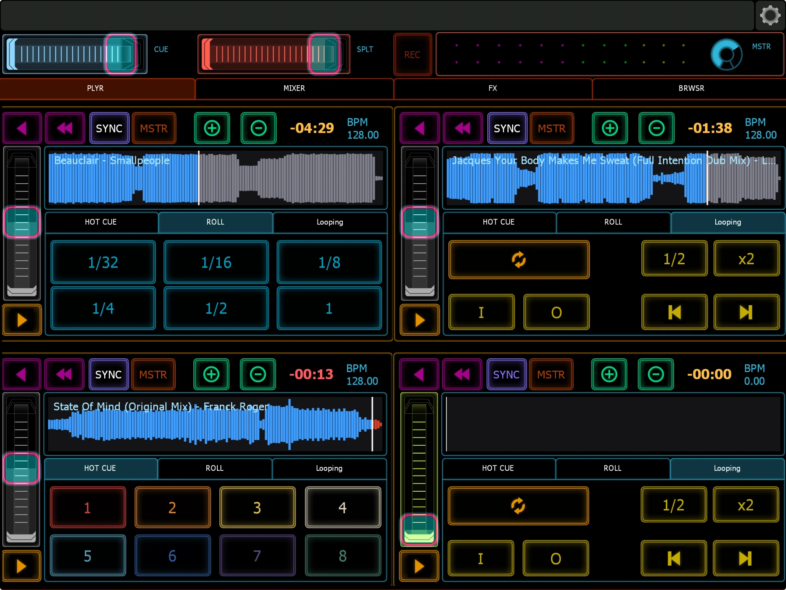
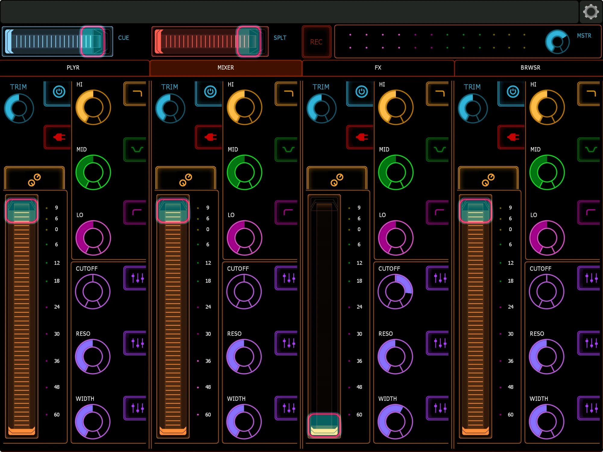
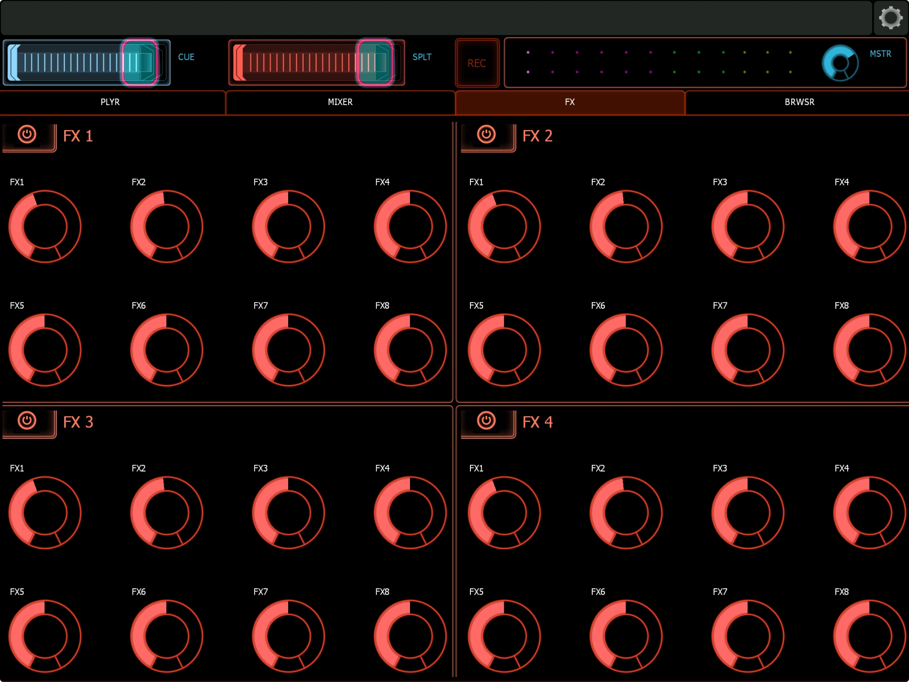
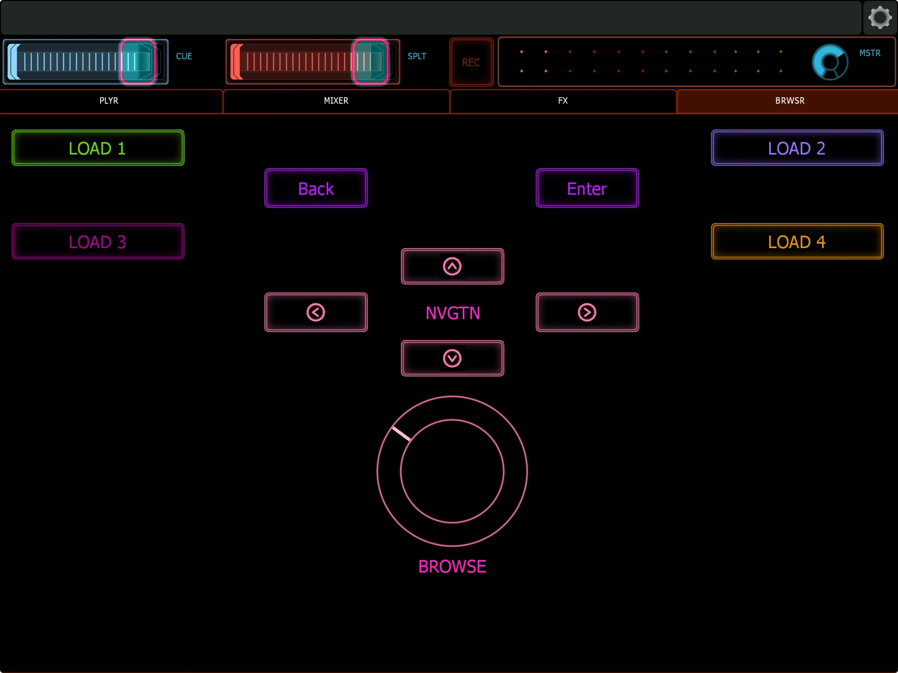

# Lemuricate for Syndicate

A 4-deck Lemur (iPad) controller template for **Syndicate**. It has two-way control: MIDI drives the decks and mixer, and OSC feedback sends meters, track title, BPM, time remaining, cue states, pitch position and a real audio waveform back to the iPad.



▶️ **[Watch it working (35 s video)](images/demo.mp4)**

| Mixer | FX | Browser |
|---|---|---|
|  |  |  |

## What's in the folder

| File | What it is |
|---|---|
| `Lemuricate-4deck.jzml` | The Lemur template. Load it on the iPad. |
| `Lemur-Syndicate-4deck.sdcmap` | The Syndicate MIDI mapping profile for all 4 decks and the mixer. |
| `syndicate_lemur_bridge.py` | Optional helper for your computer (Mac or Windows) that adds the audio waveform to each deck's display. |
| `images/` | Screenshots. |

## Requirements

- Syndicate on your computer. Built and tested on a **Mac**; the template, mapping and bridge should also work on **Windows** but haven't been tested there.
- Lemur on an iPad, on the same Wi-Fi/LAN as the computer, with Lemur Daemon installed on the computer (available for Mac and Windows).
- The waveform bridge needs:
  - **Python 3**, which comes with macOS or the Xcode command-line tools.
  - **ffmpeg**: `brew install ffmpeg` on Mac, `winget install ffmpeg` on Windows.

Write down two addresses before you start:
- **Computer IP:** on Mac, System Settings → Wi-Fi → Details; on Windows, run `ipconfig` and look for IPv4 Address. Example: `192.168.1.10`.
- **iPad IP:** Lemur → Settings, or iPad Settings → Wi-Fi → (i). Example: `192.168.1.20`.

> Give both devices a fixed IP (a DHCP reservation in your router). Otherwise the addresses below change and feedback stops working.

---

## Setup

### 1. Load the template on the iPad
1. Open `Lemuricate-4deck.jzml` in the Lemur Editor on your computer.
2. Connect to the iPad and sync the template.

### 2. Lemur MIDI (controls → Syndicate)
1. In Lemur → Settings → MIDI, set **MIDI Target 0** to your computer. Lemur Daemon is the usual choice, and it appears in Syndicate as **Daemon Input 0**.
2. In **Audio MIDI Setup → MIDI Studio → Network** you can use a network MIDI session instead. If you do, re-select the device in Syndicate (step 3).

### 3. Import the mapping into Syndicate
1. Go to Syndicate → Settings → MIDI. Import `Lemur-Syndicate-4deck.sdcmap`.
2. Make sure it's bound to the input device Lemur sends on (**Daemon Input 0**). If your input has a different name, pick it from the profile's device menu.

### 4. Lemur OSC target (refresh requests and touch-seek)
In Lemur → Settings → OSC Targets, tap **Add Target** until there is an **OSC 1**. Set it to your computer's IP, port **9090**. The template sends to target **1**, not 0. If OSC 1 is missing, the refresh on load and the OSC seek do nothing.

### 5. Syndicate OSC settings
In Syndicate → Settings → OSC:

| Setting | Value |
|---|---|
| OSC **input** | **On**, port **9090** |
| OSC **feedback** | **On** |
| Feedback host / port | **With bridge (recommended):** `127.0.0.1` port `9096`<br>**Without bridge:** iPad IP, port `8000` |
| Root | `/Syndicate/` |

OSC input has its own switch, separate from feedback. **Turn it on.** If it's off, Syndicate ignores the template's refresh request, and the BPM won't follow the master tempo until a value happens to change.

Feedback subscriptions to enable:
- `Mixer/CH1–4/Meter`
- `Deck/1–4/TrackInfo`, `Progress`, `Time`, `BPM`, `Playing`, `Sync`, `TempoSlider`, `Cues`
- `Header/BPM`

Leave **Header/Clock** and **Header/Metronome** off. They flood the connection with junk messages.

### 6. Start the waveform bridge (optional, recommended)
In Terminal:

```bash
cd /path/to/lemuricate-syndicate
python3 syndicate_lemur_bridge.py --ipad 192.168.1.20
```

Replace `192.168.1.20` with your iPad's IP (the examples in this guide use `192.168.1.10` for the computer and `192.168.1.20` for the iPad). You should see:

```
listening on 127.0.0.1:9096, forwarding to 192.168.1.20:8000
```

At startup the bridge asks Syndicate to resend its state, so the decks that are already loaded get their titles and waveforms right away.

Each time you load a track, a line like `deck 1: waveform sent for "Artist - Title" (0.7s)` appears.

Keep the Terminal window open while you play. Press **Ctrl+C** to stop.

Options: `--ipad-port` (default 8000), `--listen` (default 9096), `--syndicate-port` (default 9090), `--no-resend`, and `--log TEXT`, which prints every Syndicate message whose address contains TEXT (for debugging, e.g. `--log TempoSlider`). If you change `--listen`, change Syndicate's feedback port to match.

**On Windows** (untested): install Python 3 from python.org or the Microsoft Store, and ffmpeg with `winget install ffmpeg`. Then run the bridge from Command Prompt or PowerShell:

```bat
python syndicate_lemur_bridge.py --ipad 192.168.1.20
```

The bridge looks for Syndicate's library in `%APPDATA%` and `%LOCALAPPDATA%` (`UntitledAudioSyndicate\Syndicate\Database\Syndicate.db`). If it prints *library not found*, point it at the file with `--db "C:\path\to\Syndicate.db"`. Windows Firewall may ask to allow Python on the network; allow it on private networks.

### 7. Resend the state when the display is blank

Syndicate only sends a value when it **changes**. A deck's title, BPM, cues and waveform are sent when a track **loads**. If Lemur, the bridge or the template starts after your tracks are already loaded, the iPad shows blank decks, `--:--`, 0.00 BPM and no waveforms. Ask Syndicate to **resend its state** whenever that happens:

- **Restart the bridge.** It sends a resend request at startup.
- **Reload the template in Lemur.** On load it sends `/Syndicate/Feedback/Resend` to OSC target 1.
- **Reload the track** on that deck.
- Or send it by hand from the computer (on Windows, use `python` instead of `python3`):

```bash
python3 -c "import socket,struct;socket.socket(2,2).sendto(b'/Syndicate/Feedback/Resend\0\0,i\0\0'+struct.pack('>i',1),('127.0.0.1',9090))"
```

For any of these to work, Syndicate's **OSC input** must be on (port 9090).

---

## How it works

```
iPad (Lemur) ──MIDI──────────────► Syndicate        (decks, mixer, FX)
iPad (Lemur) ──OSC :9090─────────► Syndicate        (refresh request)
Syndicate ──OSC :9096─► bridge ──OSC :8000─► iPad   (feedback + waveform)
```

The bridge forwards every Syndicate message to the iPad unchanged. When a track loads, it also:
1. Finds the audio file in Syndicate's library database (read-only).
2. Uses ffmpeg to build a 128-point waveform.
3. Sends that waveform to the deck's canvas.

Waveforms are cached for the session, so reloading a track is instant.

---

## Using the template

### Per deck (1–4)
- **Play/Pause:** the icon follows Syndicate's real state: pause while playing, play while stopped. Each tap sends one play/pause press. If a deck was still playing when you loaded a new track, Syndicate keeps it playing, so check the icon before you tap.
- **Sync / Master:** the light follows Syndicate's Sync state.
- **Cues 1–8:** each pad uses Syndicate's colour for that slot, from Syndicate's BAUHAUS cue colour preset. A slot with a cue is lit dimly in its colour, and an empty slot is dark grey. Pressing a pad shows the full colour. If you change the cue colour preset in Syndicate, the colours in the template's `onCues` scripts need updating.
- **Slip loops:** 1/32, 1/16, 1/8, 1/4, 1/2, 1 beat.
- **Loop / Loop In / Loop Out / Beat skip ◄ ►.**
- **Tempo fader**, **Pitch bend + / −**, **Backspin**, **Reverse**.
- **Tempo fader feedback:** the fader follows the deck's real pitch position, using `/Syndicate/Deck/N/TempoSlider`, scaled from −1…+1. When Sync is on, Syndicate locks the slider and the fader turns **grey**. If you move it while it's locked, it snaps back to the deck's value when you let go.

### Deck display
- **Title:** "Title – Artist", updated when a track loads.
- **Waveform:** blue for the played part, grey for the rest. It turns **red in the last 30 seconds**. A white line marks the playhead. Without the bridge, it falls back to a blue progress bar.
- **Touch to seek:** tap anywhere on the waveform to jump to that point. Drag to scrub through the track. This is handy for old rips with no cue points. It sends two things: Syndicate's `/Syndicate/Deck/N/WaveformSeek` OSC command, through OSC target 1, and a MIDI `deck.N.waveform_seek` (channel 16, CC1–4) through the mapping. MIDI gives 128 positions across the track. Careful: a stray touch on a playing deck will jump it.
- **Key:** shown under the waveform.
- **REMAIN:** time left as `-mm:ss`. In the **last 30 seconds** it flashes red and white, once per second.
- **BPM:** with Sync **on**, it shows the master/current BPM. With Sync **off**, it shows the track's original BPM.

### Browser (BRWSR tab)
- **Arrows**, **Enter**, **Back** and **Load Deck 1–4** buttons.
- **Browse dial:** an endless dial. Turning it clockwise moves down the track list and counter-clockwise moves up, one track per small click. It works by sending Syndicate's Browser Up/Down presses, CC60/CC63 on channel 1. Use Load Deck to load the highlighted track.
  - **Sensitivity:** in the Lemur Editor, change the dial's `step` variable. The default is `0.04`, about 25 tracks per full turn. Smaller is faster.
  - Each movement sends at most 8 steps, so a fast spin can't flood Syndicate.

### Mixer (per channel)
- **Volume, Trim, EQ Low/Mid/High, Filter**, **Cue (headphones)**, **Mute** and **FX on**, plus FX macros 1–8.
- **EQ kill switches (Lo/Mid/Hi):** a kill drops that band to zero. Releasing it restores the knob to where it was before the kill.
- **FX resets (Cutoff / Reso / Width):** these send the knob back to its default. Cutoff goes to centre (50%), Reso to 50%, Width to 100%.

### Meters
- The channel meters show each channel's level.
- The master meter shows the loudest of the four channels.

---

## Troubleshooting

| Symptom | Fix |
|---|---|
| Nothing on the iPad moves (no meters, title or time) | Check Syndicate's feedback host/port: `127.0.0.1:9096` with the bridge running, or iPad IP `:8000` without it. Also check that feedback is on and the subscriptions are enabled. |
| Title, time, BPM, cues or waveform blank | Syndicate only sends track info when a track **loads**. **Resend the state**: see step 7. |
| BPM stuck on the track BPM with Sync on | Turn on Syndicate's **OSC input** (port 9090). Set Lemur's **OSC Target 1** to your computer's IP `:9090`. |
| Waveform shows only a blue bar | Check that the bridge is running and printing "waveform sent". Check that Syndicate feedback points to `127.0.0.1:9096`. Check that `ffmpeg` is installed (`which ffmpeg`). |
| Bridge says "No such file" | Run it from the project folder, or give it the script's full path. |
| Bridge can't find a track | The file has moved, or the title doesn't match Syndicate's library. Re-analyse or re-import the track in Syndicate. |
| A button controls two things | A different mapping profile is also active on the same input. Disable the other profile. |
| Meters/feedback stop after a network change | The iPad or computer IP changed. Update Syndicate's feedback host or the bridge's `--ipad` value. |

---

## Known limitations
- **BPM with Sync off** shows the track's original BPM. Moving the tempo fader doesn't change the displayed value (the fader position itself does follow).
- **Record:** Syndicate has no built-in recording. The record button is free to MIDI-map to another app, such as Ableton's Arrangement Record, or you can record the output with something like ocenaudio or Audio Hijack.
- The waveform is an overview of the whole track (128 points). It is not a zoomed, scrolling waveform.
- Built and tested with Syndicate's OSC API (root `/Syndicate/`) and Lemur 5 on iPad, on a Mac. Windows should work but hasn't been tested yet. Reports welcome.

---

Not affiliated with Untitled Audio (Syndicate) or Liine (Lemur).
